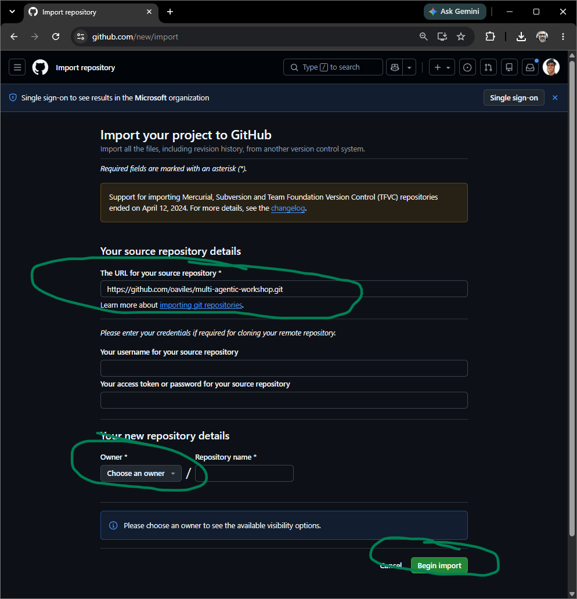
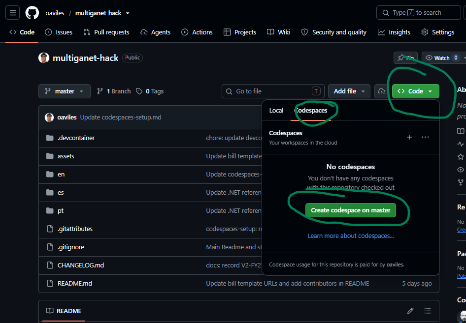
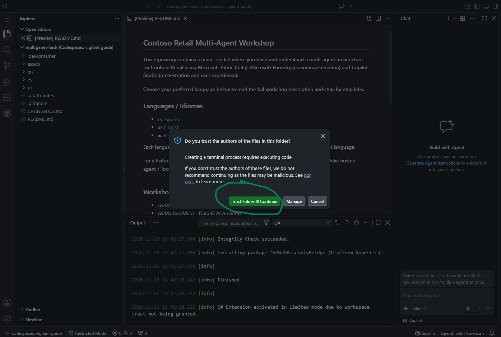
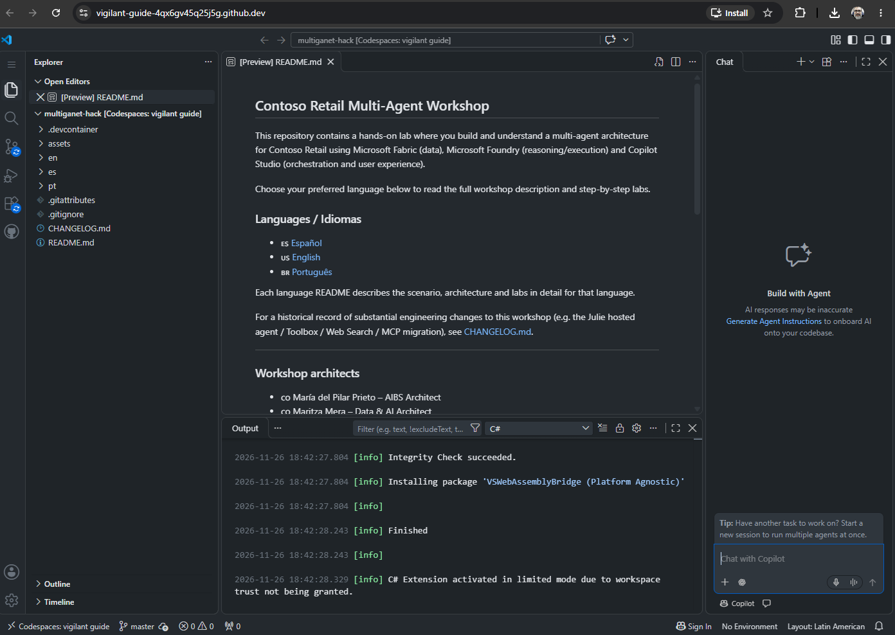

# Lab 06: Microsoft Foundry — Intro and Infrastructure Setup

Microsoft Foundry — the reasoning and execution layer of Contoso Retail's multi-agent architecture.

## 🎯 Mission Brief

This section of the workshop covers the **reasoning and execution layer** of Contoso Retail's multi-agent architecture, implemented on **Microsoft Foundry**. This is where the intelligent agents are built: they interpret data and plan actions (executing some of them) based on the information produced by the data layer (Microsoft Fabric).

## 🧭 Where this lab fits in the multi-agent architecture

### Agents in this layer

| Agent | Role | Description |
|-------|------|-------------|
| **Anders** | Executor Agent | Receives requests for operational actions (such as generating reports or rendering orders) and executes them by interacting with external services like the `FxContosoRetail` Azure Function. Type: `kind: "prompt"` with an OpenAPI tool. |
| **Julie** | Planner Workflow | Orchestrates personalized marketing campaigns. Receives a customer segment description and runs a 5-step flow: (1) extracts the customer filter, (2) calls **SqlAgent** to generate T-SQL, (3) executes the query against Fabric via **Function App OpenAPI**, (4) calls **MarketingAgent** (with Web Search) to generate per-customer messages, (5) organizes the result as a JSON email campaign. Type: `kind: "workflow"` with 3 tools (2 agents + 1 OpenAPI). |

### Overall architecture

The Foundry layer sits at the center of the three-layer architecture:

```
┌─────────────────────┐
│   Copilot Studio    │  ← Interaction layer (Charles, Bill)
├─────────────────────┤
│  Microsoft Foundry  │  ← Reasoning layer (Anders, Julie) ★
├─────────────────────┤
│  Microsoft Fabric   │  ← Data layer (Mark)
└─────────────────────┘
```

The Anders and Julie agents use GPT-5.1 models deployed in Azure AI Services to reason about business information. Anders directly consumes the `FxContosoRetail` API via an OpenAPI tool. Julie orchestrates a multi-agent workflow: it uses **SqlAgent** (generates T-SQL), a **Function App** (executes the SQL against Fabric via OpenAPI), and **MarketingAgent** (generates personalized messages with Web Search), coordinating everything autonomously as a `workflow`-type agent.

## 🔎 Objectives

By completing this lab you will:

1. Create a GitHub Codespace and verify the environment.
2. Authenticate with Azure and obtain the Microsoft Fabric parameters if available.
3. Run the deployment script and record its outputs.
4. Configure the agents, assign RBAC permissions, and verify the deployment.

---

## 0. Before you start: GitHub Codespaces

GitHub Codespaces provides a complete cloud-based development environment, pre-configured with all the necessary tools. You don't need to install anything on your machine — just a browser and access to the GitHub repository.

> [!IMPORTANT]
> **Requirement: GitHub account**
> To use GitHub Codespaces you need a GitHub account. If you don't have one yet, you can create a free account following the instructions at [https://docs.github.com/en/get-started/start-your-journey/creating-an-account-on-github](https://docs.github.com/en/get-started/start-your-journey/creating-an-account-on-github).

### What's included in the environment?

| Tool | Pre-installed |
|---|---|
| .NET 10 SDK | ✅ |
| Azure CLI (latest version) | ✅ |
| PowerShell 7+ | ✅ |
| C# Dev Kit (VS Code extension) | ✅ |
| Bicep (VS Code extension) | ✅ |
| REST Client (VS Code extension) | ✅ |

---

## 1. Access the repository on GitHub

a. Open your browser and navigate to the workshop GitHub repository URL provided by your instructor.

b. Sign in to GitHub.

c. Import the workshop repo to your github account:
  - New repo: https://github.com/new/import
  - The URL for your source repository: https://github.com/oaviles/multi-agentic-workshop.git
  - Choose a owner: choose your github account
  - Press green botton Begin import



---

## 2. Create the Codespace

a. On the repository home page, click the green **`< > Code`** button.

b. Select the **Codespaces** tab.

c. Click **"Create codespace on master"**.

> [!NOTE]
> If you see an option to choose the machine type, the **2-core** option is more than enough for this workshop.

d. Wait **2 to 4 minutes** while GitHub builds the environment. You will see a loading screen with build logs. **This only happens the first time** — subsequent sessions start in seconds because the environment is saved.



e. When the environment is ready, **VS Code will open in the browser** with all repository files already available in the left panel. If is necesary select the green botton "Trust Folder & Continue"



f. Then the enviroment will be ready to start using.



---

## 3. Verify the environment is ready

Open the integrated terminal with <kbd>Ctrl</kbd>+<kbd>`</kbd> (or **Terminal → New Terminal**) and run the following three commands to confirm everything is installed:

```bash
dotnet --version
```
You should see something like `10.0.xxx`.

```bash
az version
```
You should see the installed Azure CLI version (JSON with `"azure-cli": "2.x.x"`).

```bash
pwsh --version
```
You should see `PowerShell 7.x.x`.

If all three respond correctly, restore the workshop .NET dependencies:

```bash
dotnet restore en/labs/foundry/code/workshop-multi-agentic.sln
```

The environment is ready for the next steps.

---

## 4. Authenticate with Azure

> [!NOTE]
> **Your unique resource suffix is generated automatically** from your Azure subscription ID (a globally unique UUID). You don't need to enter any tenant number or manual identifier.

In the Codespace terminal, run:

```bash
az login --use-device-code
```

> [!IMPORTANT]
> It is important to use `--use-device-code` in Codespaces. The normal flow (`az login`) tries to open a local browser from the remote server, which does not work correctly in this environment. Remember to open the authentication URL in your local browser, where you are logged in with your lab account created for the workshop (the one ending in `@azurehol<number>.com`).

You will see output similar to this:

```
To sign in, use a web browser to open the page https://microsoft.com/devicelogin
and enter the code XXXXXXXX to authenticate.
```

Follow these steps:
1. Open `https://microsoft.com/devicelogin` in your browser (in a new tab).
2. Enter the 8-character code shown in the Codespace terminal.
3. Select the **workshop Azure account** (the one ending in `@azurehol<number>.com`).
4. Authorize access when prompted.
5. Return to the Codespace terminal — within a few seconds you will see the list of available subscriptions.

Verify that the active subscription is correct:

```bash
az account show --output table
```

If you need to change it:

```bash
az account set --subscription "subscription-name-or-id"
```

---

## 5. Obtain the Microsoft Fabric parameters

For Lab 4 (Julie/SqlAgent), you will need two values from the Fabric Warehouse:

- **FabricWarehouseSqlEndpoint**: SQL endpoint of the Warehouse, without `tcp://` or port. Example: `xyz.datawarehouse.fabric.microsoft.com`
- **FabricWarehouseDatabase**: exact full name of the database.

To obtain them from the Fabric portal, follow the [sql-parameters.md](./setup/sql-parameters.md) guide.

> [!NOTE]
> If you don't have these values yet, you can skip them. The deployment will continue without them and the rest of the infrastructure will be created correctly. You can configure the SQL connection manually later from the Azure portal.

---

## 6. Run the deployment script

In the Codespace terminal, navigate to the script folder:

```bash
cd en/labs/foundry/setup/op-flex
```

Run the deployment script (using `pwsh` to start PowerShell 7):

```bash
pwsh ./deployFromAzure.ps1
```

The script will only ask for optional parameters. Press <kbd>Enter</kbd> to accept the default values for `Location` and `ResourceGroupName`:

```
Press Enter for default.
Location [eastus]:
ResourceGroupName [rg-contoso-retail]:
Do you want to configure the Fabric SQL connection for Lab04 now? (y/N): y
FabricWarehouseSqlEndpoint (no protocol, no port): kqbvkknqlijebcyrtw2rgtsx2e-dvthxhg2tsuurev2kck26gww4q.database.fabric.microsoft.com
FabricWarehouseDatabase: retail_sqldatabase_danrdol6ases3c-6d18d61e-43a5-4281-a754-b255fc9a6c9b
```

You will see the plan confirmation before execution begins:

```
========================================
 Multi-Agent Workshop - Deployment
 Plan: Flex Consumption (FC1 / Linux)
 Mode: Azure Cloud Shell
========================================

  Subscription:   My Azure Subscription (xxxxxxxx-xxxx-xxxx-xxxx-xxxxxxxxxxxx)
  Suffix:         ab3f2
  Location:       eastus
  Resource Group: rg-contoso-retail
  Fabric SQL:     kqbvkknqlijebcyrtw2rgtsx2e-...
  Fabric DB:      retail_sqldatabase_...
```

You will then see the deployment progress resource by resource:

```
  ⏳ CognitiveServices/accounts/ais-contosoretail-ab3f2 ...
  ✅ Storage/storageAccounts/stcontosoretailab3f2
  ✅ Web/serverFarms/asp-contosoretail-ab3f2
  ✅ Web/sites/func-contosoretail-ab3f2
  ✅ CognitiveServices/accounts/ais-contosoretail-ab3f2
  ✅ Code published successfully.
```

The full process takes between **5 and 10 minutes**.

> [!IMPORTANT]
> **Take note of the final output!** When finished, the script displays the names and URLs of all created resources. You will need these values to configure the agents in the following steps.

---

## 7. Record the deployment outputs

When finished, note these values from the script output:

| Script output | Description | Where it's used |
|---|---|---|
| `Unique suffix` | 5 characters, e.g.: `ab3f2` | To identify your resources in Azure |
| `Function App Base URL` | API base URL | `appsettings.json` for Anders and Julie |
| `Foundry Project Endpoint` | Foundry project endpoint | `appsettings.json` for Anders and Julie |
| `Subscription ID` | Subscription ID | `appsettings.json` for Julie (RBAC) |
| `Resource Group` | Resource group name | `appsettings.json` for Julie (RBAC) |

---

## 8. Configure the agents' appsettings.json

### Anders (Lab 7)

In the Codespace file panel, open:
`en/labs/foundry/code/agents/AndersAgent/ms-foundry/appsettings.json`

Replace the `<suffix>` values with the suffix you obtained in the previous step:

```json
{
  "FoundryProjectEndpoint": "https://ais-contosoretail-<suffix>.services.ai.azure.com/api/projects/aip-contosoretail-<suffix>",
  "ModelDeploymentName": "gpt-deployment",
  "FunctionAppBaseUrl": "https://func-contosoretail-<suffix>.azurewebsites.net/api"
}
```

### Julie (Lab 9)

Open `en/labs/foundry/code/agents/JulieAgent/appsettings.json` and fill in all values using the deployment outputs noted in section 7.

---

## 9. Assign RBAC permissions in Foundry

For agents to be created and run, your user needs the **Cognitive Services User** role on the AI Services resource. Without this role you will get a `PermissionDenied` error when trying to create agents.

Run the `assign-role.sh` script from the `setup` folder. If you are coming from section 6 (you are in `setup/op-flex`), just go up one level:

```bash
cd ..
bash assign-role.sh
```

Wait **1 minute** for the permission to propagate before running the agents.

> [!NOTE]
> If you get a `RoleAssignmentExists` error, the role was already assigned automatically by the deployment script. You can continue.

> [!NOTE]
> **Hosted agents (Lab 4).** Julie is deployed as a hosted agent and runs under her own Microsoft Entra identity, which needs the **Foundry User** role on the project. The Julie deployer creates that assignment for you, so your own user must hold **Foundry Project Manager** at the project scope or **Owner** on `rg-contoso-retail`. If it cannot, the deployer prints the exact `az role assignment create` command for an administrator to run.

---

## 10. Verify the deployment

Confirm that all resources were created correctly:

```bash
az resource list --resource-group rg-contoso-retail --output table
```

The result should include these resources:

| Resource            | Name                            | Description |
| ------------------- | ------------------------------- | ----------- |
| Storage Account     | `stcontosoretail{suffix}`       | Storage for the Function App |
| App Service Plan    | `asp-contosoretail-{suffix}`    | Flex Consumption hosting plan |
| Function App        | `func-contosoretail-{suffix}`   | Contoso Retail API (.NET 8, dotnet-isolated) |
| AI Foundry Resource | `ais-contosoretail-{suffix}`    | AI Services + Foundry projects with GPT-5.1 |
| AI Foundry Project  | `aip-contosoretail-{suffix}`    | Working project in Foundry |

> [!NOTE]
> The Web Search Toolbox used by `MarketingAgent` doesn't appear here: it isn't an ARM resource, it's created automatically when `JulieAgent` runs (a data-plane call, same as agent creation).

> [!NOTE]
> The `{suffix}` is a unique 5-character identifier generated automatically from your subscription ID. This ensures that resource names don't collide between participants.

---

## Codespace management

### Pause (to conserve free hours)

The Codespace pauses automatically after **30 minutes of inactivity**. You can also pause it manually from the Codespaces tab on GitHub. Your files and configuration are preserved between sessions.

### Resume a saved session

- Go to the repository on GitHub → **Code** → **Codespaces** → click your existing Codespace.
- The environment reopens in seconds with everything as you left it.
- Verify that the Azure CLI session is still active with `az account show`. If it expired, repeat section 4.

### Delete when the workshop is finished

To free up your quota hours:
- Go to `github.com/codespaces`
- Find your Codespace → click `···` → **Delete**.

> [!WARNING]
> Deleting the Codespace will lose any uncommitted local changes. If you modified `appsettings.json` files and want to save them, copy them somewhere safe before deleting.

### Available free hours

GitHub offers **120 hours/month** free on 2-core machines for personal accounts. An 8-hour workshop uses only 7% of the monthly limit.


## Mission Complete

Once setup is complete, continue with Lab 7.
