# Lab 4: Anders agent powered by Foundry IQ (Enterprise Knowledge).

In this lab, you will learn how to ground an AI Agent using **Foundry IQ Knowledge Bases**. You will connect an Foundry IQ resource, configure a Knowledge Base using data from Azure Blob Storage, link it to an Agent (`Anders`), and test grounded knowledge extraction and document summarization in the Agent Playground.

## Objectives

By the end of this lab, you will be able to:

1. Connect and create a **Foundry IQ** resource in Microsoft Foundry.

2. Create and configure a new **Knowledge Base** connected to an Azure Blob Storage container.

3. Attach the configured Knowledge Base to an Agent in the Playground.

4. Execute queries to verify agent responses powered by external knowledge grounding and document analysis.

## Prerequisites

Before starting this lab, ensure you have:

* Access to **Microsoft Foundry** portal (`Foundry`).

* An active Azure Subscription with appropriate permissions to create AI Search resources.

* An existing Azure Storage Account and Blob Container containing domain documents (e.g., product specification sheets/PDFs).

* An existing Agent created in Microsoft Foundry (`Anders`).

## Step 1: Navigate to Agent Knowledge Settings

In this step, you will locate your target agent within the Microsoft Foundry portal workspace and open the configuration dialog required to attach external Knowledge Sources.

1. **Access the Microsoft Foundry Workspace:**
   * Open your web browser and navigate to the **Microsoft Foundry** portal (`https://ai.azure.com` or your designated Foundry workspace URL).
   * Ensure you are logged into the correct tenant and project workspace.

2. **Navigate to the Agents Overview:**
   * In the top navigation bar, ensure you are in the **Build** tab.
   * On the left-hand navigation menu, locate the **Build** section and click on **Agents**.
   * The main panel will display a list of all currently configured agents within your project, along with metadata such as *Name*, *Version*, *Status*, *Type*, and *Last updated*.

   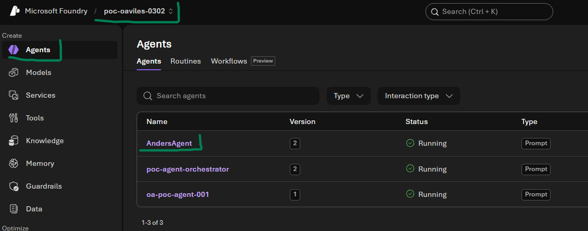

3. **Open the Target Agent (`Anders`):**
   * From the **Agents** list table, locate and click on **Anders** (or your designated agent's name link).
   * This opens the **Playground** pane for `Anders`, displaying the agent configuration controls on the left (Model, Instructions, Tools, Knowledge, Memory) and the interactive **Chat / YAML** canvas on the right.

4. **Locate the Knowledge Configuration Panel:**
   * On the left configuration panel, scroll down past the **Instructions** and **Tools** accordions until you see the **Knowledge** section.
   * Read the section description: *"Add knowledge bases for grounding. Learn more about best practices."*

5. **Initiate the Foundry IQ Connection Dialog:**
   * Under the **Knowledge** heading, click the **Add** dropdown button.
   * Select **Connect to Foundry IQ** from the option list.

    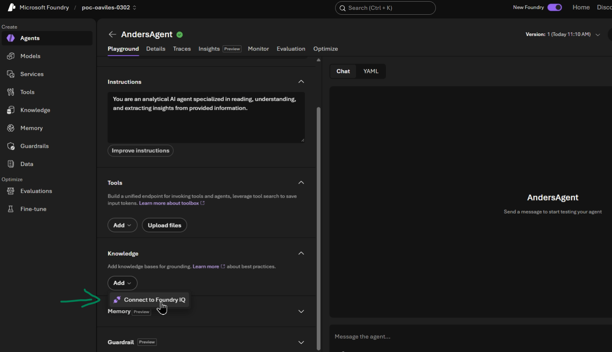

   * A modal pop-up window titled **Connect to Foundry IQ** will appear on your screen with options for specifying an Azure AI Search connection and selecting a Knowledge Base.
   * If no existing search resource is connected to this agent, click the link titled **Connect to an AI Search resource** inside the dialog to proceed to the resource setup page.

   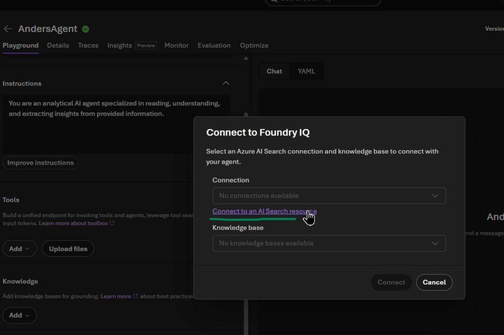

## Step 2: Provision a Foundry IQ Resource

1. In the **Knowledge (Foundry IQ)** portal page, click **Create new resource** (or select **Connect to an AI Search resource**).

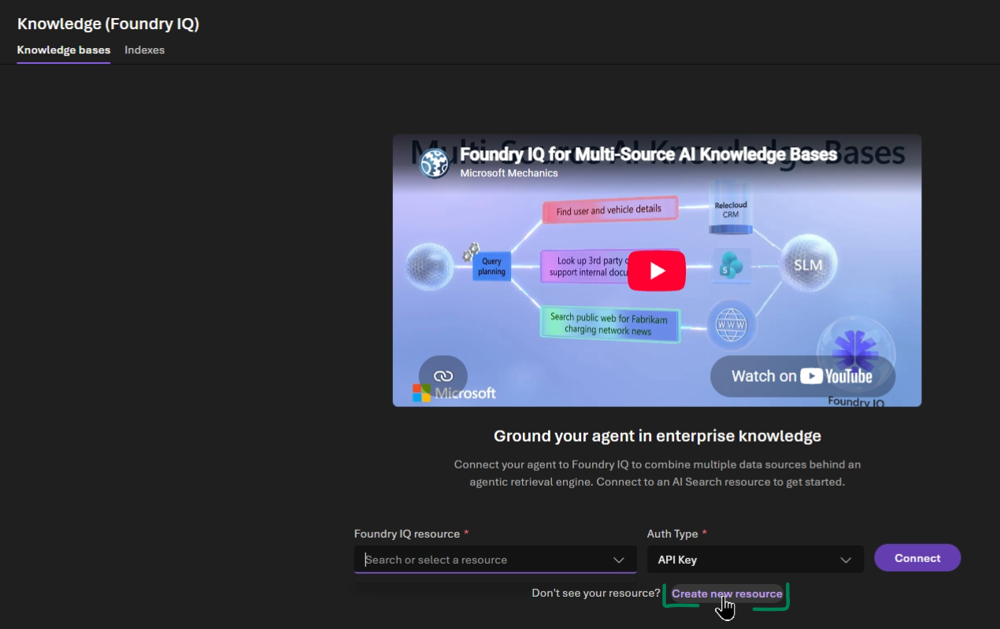

2. On the **Create Foundry IQ resource** blade, fill in the following configuration parameters:

| Field | Description / Selection | 
| ----- | ----- | 
| **Subscription** | Select your active Azure Subscription | 
| **Resource group** | Select your target resource group | 
| **Region** | Select an supported Azure region (e.g., `Central US`) | 
| **Pricing tier** | Select **Serverless** or desired capacity tier | 

3. Select the check box acknowledging additional usage costs.

4. Click **Create**.

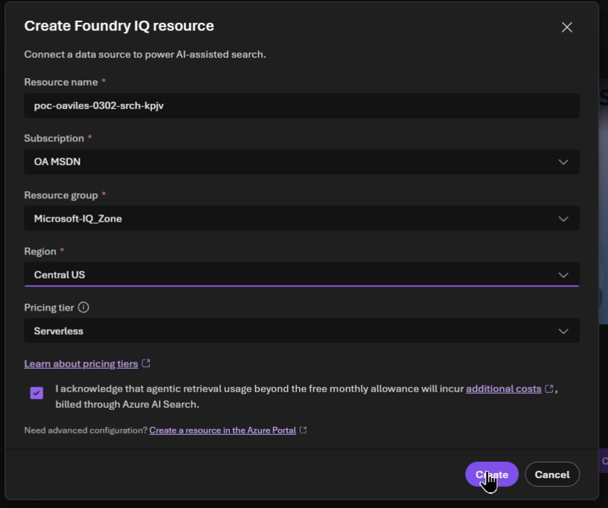

5. Wait for the secure access setup and role assignments (`Search Service Contributor`, `Search Index Data Contributor`) to complete.

## Step 3: Create a Knowledge Base

1. Once connected, click the **Create a knowledge base** button on the Foundry IQ Knowledge Base overview screen.

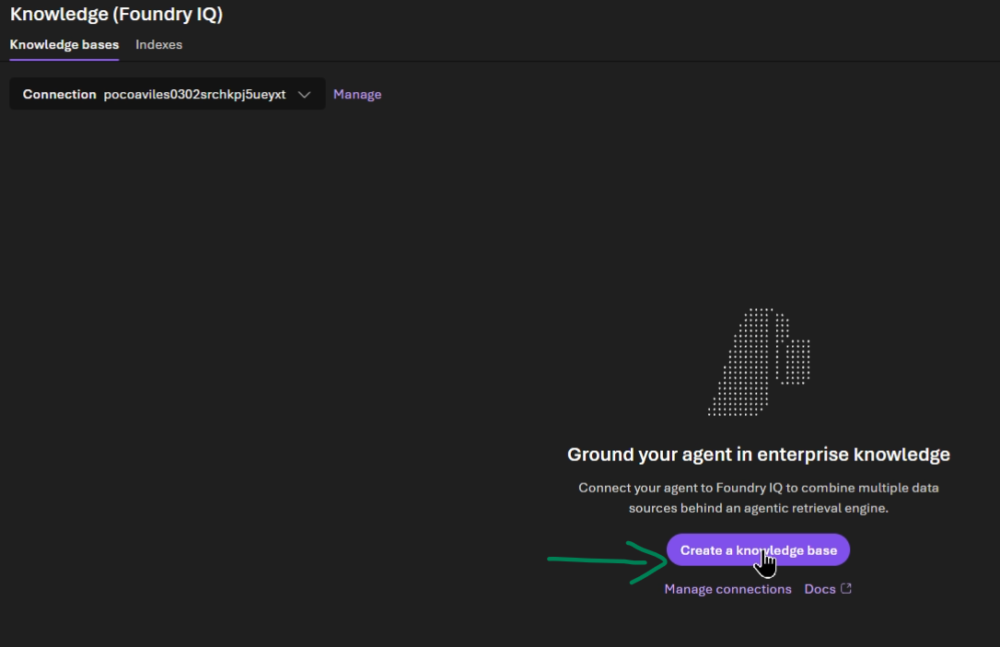

2. Under **Basic configuration**, configure the following:

   * **Name**: Enter a unique name for your knowledge base (e.g., `knowledgebase139`).

   * **Chat completions model**: Select `gpt-4.1` (or your preferred global deployment model).

   * **Retrieval reasoning effort**: Set to `Minimal` or `Normal`.

3. Under **Knowledge sources (Foundry IQ)**, click **Add sources** and select **Azure Blob Storage**.

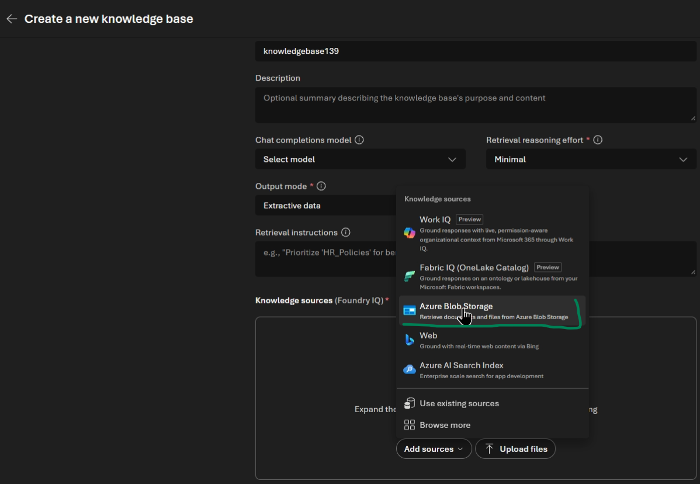

## Step 4: Configure Data Source (Azure Blob Storage)

1. In the **Create a knowledge source** pane, configure the following:

   * **Storage account**: Select your Azure Storage Account containing the documents (e.g., `ke-azundlab-570`).

   * **Container name**: Select your target blob container (e.g., `bikes`).

   * **Auth type**: `API Key` or Managed Identity.

   * **Embedding model**: `text-embedding-3-small`.

   * **Chat completions model**: Select `gpt-4.1`.

2. Click **Create**.

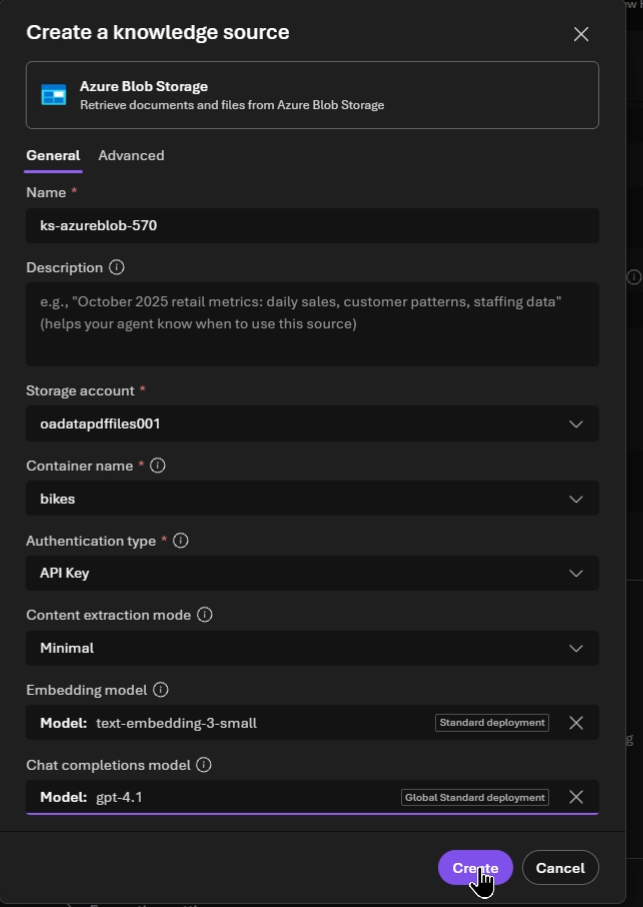

3. Review the creation status under **Knowledge sources**. Wait until the indexing status finishes provisioning.

4. Click **Save knowledge base** at the top right corner.

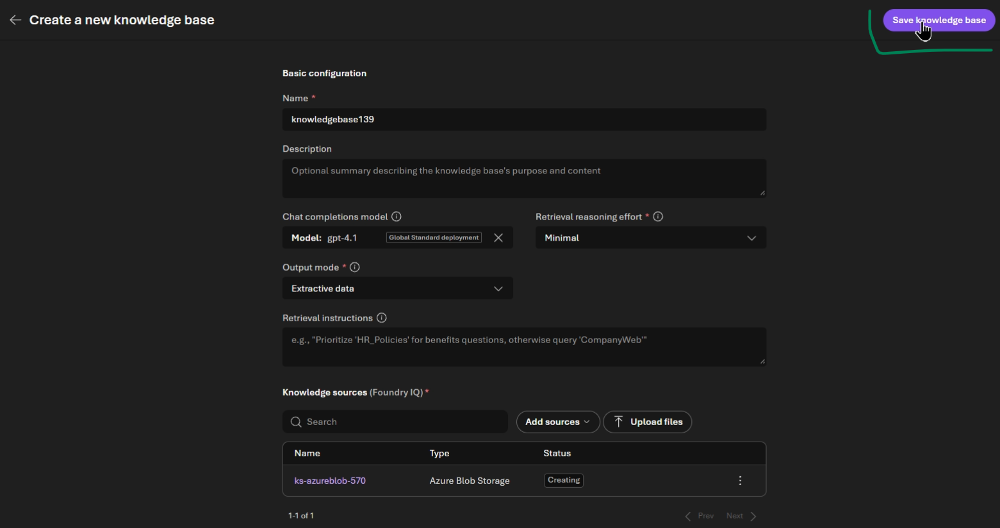

## Step 5: Attach Knowledge Base to Agent

1. After saving, click **Use in an agent** in the upper right header, or navigate back to **Build** > **Agents** > **Anders**.

2. In the `Anders` **Playground** section:

   * Scroll down to the **Knowledge** section on the left sidebar.

   * Click **Add** > **Connect to Foundry IQ**.

   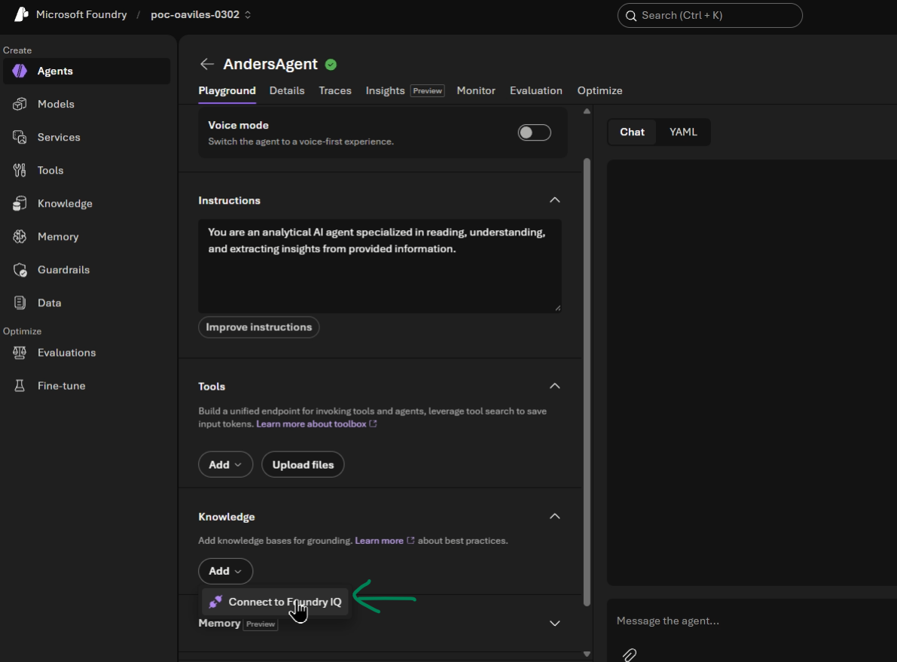

   * In the modal window, select your Connection and choose the newly created **Knowledge base** (`knowledgebase139`).

   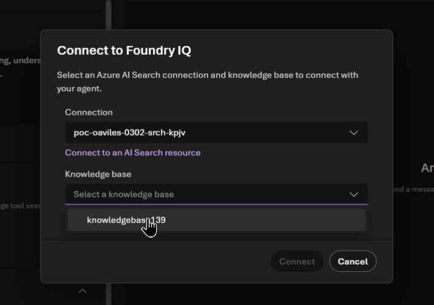

   * Click **Connect**.

3. Verify that `knowledgebase139` now appears active under the **Knowledge** section of `Anders`.

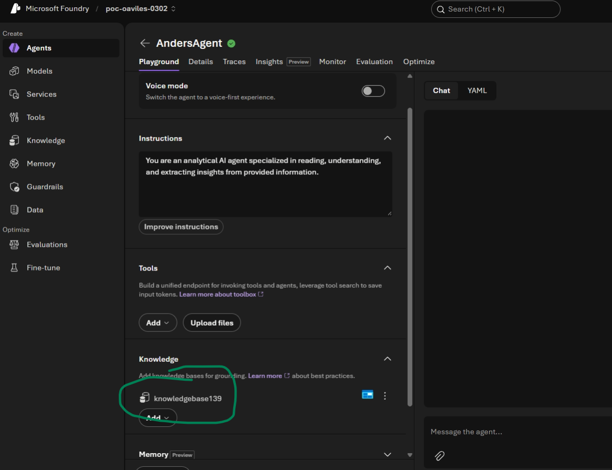

## Step 6: Test Grounding in Playground

1. In the Chat panel on the right side of the Playground, test general knowledge vs grounded behavior.

2. **Query 1:** Ask a domain query regarding products in your uploaded dataset:

   ```
   Suggest for me the best 2 bikes options to use in an XC competition and for daily use and summary your answer and include and comparative table
   ```

   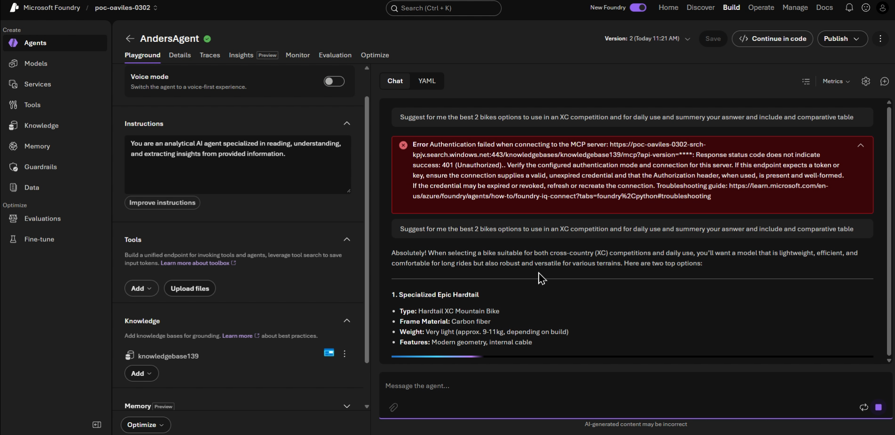

3. The agent will respond with detailed product recommendations, key feature bullet points, a summary, and a comparative table comparing attributes like Frame Material, Weight, and Price Range.

4. **Query 2 (Document Summarization Grounding):** Request a specific document summary from the knowledge base using file metadata:

   ```
   give a summary of the page 4 of the document "127938_Scalpel29er_EN_SCR.pdf" you can find the document using the knowledge base called "knowledgebase139"
   ```

    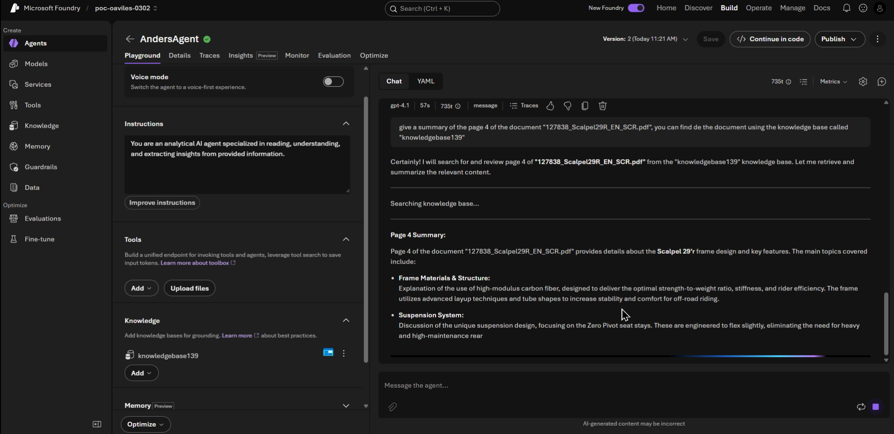

5. Observe the execution path:

   * The Agent triggers a **Searching knowledge base...** call against `knowledgebase139`.

   * The Agent retrieves the specific content for `127938_Scalpel29er_EN_SCR.pdf` page 4.

   * The Agent synthesizes and outputs structured sections covering **Frame Materials & Structure**, **Suspension System**, **Geometry**, and **Additional Features**.

## Summary

In this lab, you successfully:

* Provisioned a **Foundry IQ** search resource in Microsoft Foundry.

* Created a Knowledge Base indexing unstructured documents stored in Azure Blob Storage.

* Linked the Knowledge Base to an AI Agent (`Anders`).

* Verified grounded RAG (Retrieval-Augmented Generation) responses and specific page-level document summarization.


## Next step

Continue with [Lab 4 — Anders — Enterprise Knowledge powered by Foundry IQ](lab04-anders-foundryiq.en.md).

